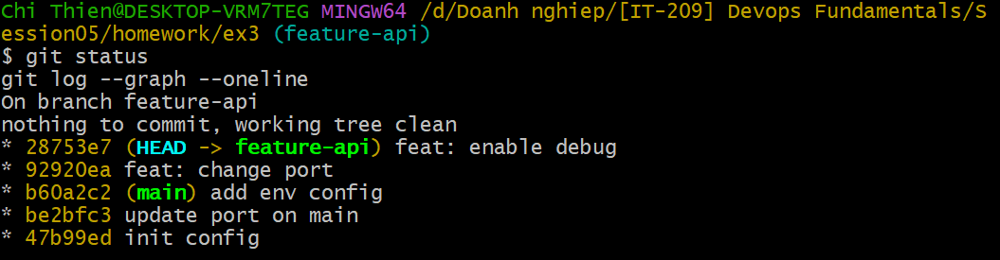

# Bài 3: Xử lý xung đột phức tạp trong quá trình Rebase

## 1. Mục tiêu

Thực hành giải quyết xung đột từng bước trong quá trình Rebase và đưa lịch sử nhánh `feature-api` lên trên nhánh `main` mà không tạo Merge Commit.

## 2. Các nhánh

- Nhánh chính: `main`
- Nhánh tính năng: `feature-api`
- File xảy ra conflict: `config.json`

## 3. Lịch sử trước khi Rebase

Nhánh `main` có các commit:

```text
init config
update port on main
add env config
```

Nhánh `feature-api` có các commit:

```text
feat: change port
feat: enable debug
```

Hai nhánh cùng thay đổi nội dung trong `config.json`, vì vậy khi thực hiện Rebase đã phát sinh xung đột.

## 4. Thực hiện Rebase

Chuyển sang nhánh `feature-api`:

```bash
git checkout feature-api
```

Thực hiện Rebase:

```bash
git rebase main
```

## 5. Conflict lần 1

Conflict lần thứ nhất xảy ra khi Git áp dụng commit:

```text
87c3211 feat: change port
```

Git báo:

```text
CONFLICT (content): Merge conflict in config.json
```

Kiểm tra trạng thái bằng:

```bash
git status
```

Khi đó Git xác nhận:

```text
both modified: config.json
```

Tôi mở file `config.json`, giải quyết conflict thủ công và xóa các conflict marker:

```text
<<<<<<<
=======
>>>>>>>
```

Sau khi giải quyết xong, thực hiện:

```bash
git add config.json
git rebase --continue
```

Commit sau khi Rebase được tạo lại với mã:

```text
92920ea feat: change port
```

## 6. Conflict lần 2

Sau khi tiếp tục Rebase, Git áp dụng commit tiếp theo:

```text
3095481 feat: enable debug
```

Conflict lần thứ hai tiếp tục xảy ra tại:

```text
config.json
```

Git báo:

```text
CONFLICT (content): Merge conflict in config.json
```

Tôi tiếp tục mở `config.json`, giải quyết thủ công conflict và giữ lại các thay đổi cần thiết của cả `main` và `feature-api`.

Sau đó thực hiện:

```bash
git add config.json
git rebase --continue
```

Commit sau khi Rebase được tạo lại với mã:

```text
28753e7 feat: enable debug
```

## 7. Kiểm tra sau khi Rebase

Kiểm tra trạng thái:

```bash
git status
```

Kết quả:

```text
On branch feature-api
nothing to commit, working tree clean
```

Kiểm tra lịch sử:

```bash
git log --graph --oneline
```

Kết quả:

```text
* 28753e7 (HEAD -> feature-api) feat: enable debug
* 92920ea feat: change port
* b60a2c2 (main) add env config
* be2bfc3 update port on main
* 47b99ed init config
```

Lịch sử sau Rebase được sắp xếp thẳng hàng, không có Merge Commit.

Các commit của `feature-api` nằm nối tiếp phía trên các commit mới nhất của `main`.

## 8. Kết quả cuối cùng

File `config.json` sau khi giải quyết conflict:

```json
{
  "port": 9000,
  "debug": true,
  "env": "production"
}
```

Quá trình Rebase đã hoàn thành thành công.

## 9. Ảnh minh chứng

Ảnh bên dưới thể hiện kết quả `git status` và `git log --graph --oneline` sau khi Rebase hoàn tất.


